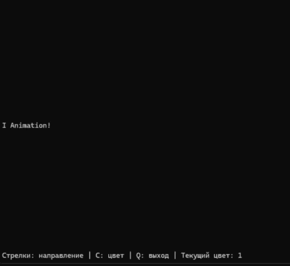

# Лабораторная работа 0: Бегущая цветная строка

Программа реализует анимацию бегущей строки в терминале на языке Python.

## Демонстрация выполнения работы программы



## Описание задачи

Необходимо разработать программу, в которой строка текста движется по горизонтали через экран и зацикливается. Пользователь может изменять направление движения стрелками клавиатуры и переключать цветовую схему. При выходе из программы терминал должен корректно восстановить исходное состояние: вернуть видимость курсора и сбросить цвет текста.

## Программа реализована на языке:

| Язык | Интерпретатор/Версия | Среда разработки |
| :--- | :--- | :--- |
| Python | Python 3.15 | PyCharm Community Edition |

## Используемые библиотеки и модули

Используются стандартные библиотеки Python:

* `os` — очистка экрана терминала.
* `sys` — вывод текста и управляющих ANSI-последовательностей.
* `time` — управление частотой обновления анимации.
* `shutil` — получение текущего размера терминала.
* `msvcrt` — неблокирующее считывание клавиш в Windows.

Дополнительная установка библиотек не требуется.

## Описание возможностей

* Непрерывное горизонтальное движение строки `Computer Graphics ASCII Animation!`.
* Зацикливание: после выхода за границу терминала строка появляется с противоположной стороны.
* Изменение направления движения с помощью стрелок влево и вправо.
* Переключение между пятью цветовыми схемами.
* Автоматическая адаптация к изменению размера окна терминала.
* Сброс цвета и восстановление видимости курсора при завершении программы.

### Управление

| Клавиша | Действие |
| :--- | :--- |
| `←` | Движение влево |
| `→` | Движение вправо |
| `C` | Переключить цвет |
| `Q` | Выход из программы |

## Установка и запуск

1. Скачайте репозиторий или файл `main.py`.
2. Откройте папку с файлом `main.py` в Проводнике Windows.
3. В адресной строке папки введите `cmd` и нажмите `Enter`.
4. Выполните следующую команду:

```bash
python main.py
```

## Использование программы

1. После запуска в терминале появится движущаяся строка.
2. Нажмите `←` или `→`, чтобы изменить направление движения.
3. Нажимайте `C`, чтобы последовательно переключать цвета.
4. Для завершения нажмите `Q` или используйте `Ctrl+C`.
